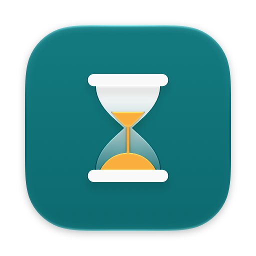
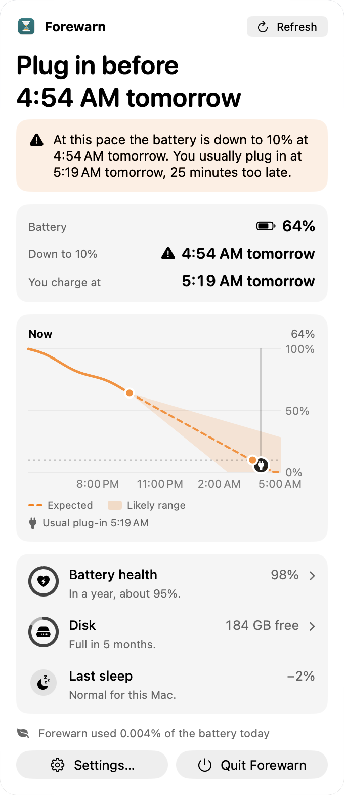
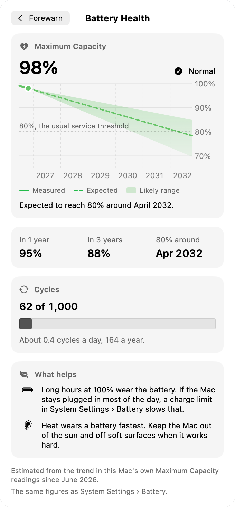

<p align="center">
  
</p>

<h1 align="center">Forewarn</h1>

<p align="center">
  <b>Your Mac, warned before it runs out.</b><br>
  A menu bar app that learns how you use this Mac and tells you, with the time it will happen,<br>
  when the battery, the disk or your mobile data are about to run out.
</p>

<p align="center">
  <a href="#install">Install</a> ·
  <a href="#build-from-source">Build from source</a> ·
  <a href="CHANGELOG.md">Changelog</a>
</p>

<p align="center">
  
  
  
  <a href="LICENSE"></a>
</p>

<p align="center">
  <picture>
    <source media="(prefers-color-scheme: dark)" srcset="docs/images/popover-dark.png">
    
  </picture>
  &nbsp;
  <picture>
    <source media="(prefers-color-scheme: dark)" srcset="docs/images/health-dark.png">
    
  </picture>
</p>

## What it warns you about

Every warning says what will happen, when, and why, in a sentence, with one thing you can do about it.

| | In Forewarn's words |
|---|---|
| **Battery** | *Battery Reaches 10% Around 15:40.* You usually plug in around 18:00. Charge when you can. |
| **Disk** | *Disk Full in About 3 Weeks.* 42 GB free. DerivedData grew by 9 GB this week. |
| **Sleep drain** | *Lost 18% While Asleep.* Usually about 2% a night. Docker kept the Mac awake. |
| **Mobile data** | *Mobile Data Runs Out Thursday 29 October.* 18 GB of 20 GB used. At this pace you reach the limit before it resets. |
| **Battery health** | At most once a month, and only when something changed. |
| **Charger** | *The charger can't keep up.* In the menu bar and the popover only, when the Mac drains while plugged in: the charger's watts, the loss per hour, and when the battery would be empty. |

The menu bar shows the time left at a glance. Click it for the forecast: the headline answer, the numbers behind it,
a chart with the likely range, and pages for Battery Health and Disk. On a Mac without a battery, disk and data
warnings remain.

## How it knows

- **It measures** battery, power, disk, sleep and the byte totals of expensive networks through public macOS APIs.
  On first launch it reads the battery history macOS already keeps, so forecasts start within days.
- **It forecasts ranges, not single guesses.** A seasonal baseline learns this Mac's hours and weekdays. An
  on-device time-series model (Timestral, Core ML) takes over only when it beats the baseline on this Mac's own
  history, checked every week.
- **It decides with plain rules.** When you usually plug in, the chance of reaching 10% before then, which folders
  grew. No cloud, no AI service.
- **It stays quiet.** At most one warning of each kind a day. Close three of a kind in a row and Forewarn waits
  longer before the next one, and says so in Settings.

## Private by design

- Everything stays in `~/Library/Application Support/Forewarn`. No account, no analytics, no network connections.
- It counts how much data goes through a network, never what is in it.
- Folder sizes for disk warnings are added up once a week, on power; Downloads only if you allow it.
- Settings › Privacy exports every measurement as CSV, or deletes it all.

## Light on the battery

Forewarn measures its own energy use and shows it in the popover. The budget it is built to: Activity Monitor's
Energy Impact near zero, at most 0.05% of the battery a day, no timer more frequent than five minutes while the
popover is closed, and never waking the Mac. The forecast model runs about 9 ms per forecast, only on battery, only
when the measured level leaves the expected range.

## 27 languages

English, Bulgarian, Catalan, Croatian, Czech, Danish, Dutch, Estonian, Finnish, French, German, Greek, Hungarian,
Irish, Italian, Latvian, Lithuanian, Maltese, Norwegian Bokmål, Polish, Portuguese, Romanian, Slovak, Slovenian,
Spanish, Swedish and Ukrainian. Forewarn follows the Mac's language or one you choose in Settings. Every language
but English is a machine translation: corrections from native speakers are the most useful contribution right now.

## Install

Requires macOS 26 or later. Forewarn is signed by Morfex S.R.L. and notarized by Apple. Install it with Homebrew:

```sh
brew tap lrzdeveloper/forewarn https://github.com/lrzdeveloper/forewarn
brew install --cask lrzdeveloper/forewarn/forewarn
```

`brew upgrade` brings new versions. Or download the DMG from
[the latest release](https://github.com/lrzdeveloper/forewarn/releases/latest) and drag Forewarn to Applications.

## Build from source

Requirements: macOS 26 or later, Xcode 26 or later, Homebrew.

```sh
brew install xcodegen swiftlint swiftformat
git clone https://github.com/lrzdeveloper/forewarn.git && cd forewarn
make hooks      # pre-push hook: runs the full check before every push
make run        # generate the Xcode project, build, launch into the menu bar
```

| Command | What it does |
|---|---|
| `make check` | Everything CI runs: lint, logic tests, build, translations, UI tests |
| `make run` | Build and launch into the menu bar |
| `make sample STATE=risky\|fine\|charging\|plugged\|learning\|shortfall` | Launch with sample data, to see forecasts before any history exists |
| `make welcome` | Launch as on first run, with the welcome window |
| `make debug` | Launch with the hidden debug window: raw series and event log |
| `make test` | Logic tests in `ForewarnKit` (`swift test`, no app host) |
| `make uitest` | End-to-end UI tests that launch the real app and click through it. Keep the Forewarn icon visible if you use a menu bar manager, and leave the mouse alone while they run |
| `make l10n` | Fails while any string the app shows lacks a translation |
| `make model` | Convert and install the optional Timestral model (weights are not part of the repository) |
| `make lint` / `make format` | SwiftFormat and SwiftLint, check or fix |
| `make release` / `make publish` | Notarized DMG and Homebrew cask; publish adds the GitHub release and the cask in `Casks/` (needs a Developer ID) |

To sign with your own team, create `Forewarn.local.xcconfig`:

```
DEVELOPMENT_TEAM = YOURTEAMID
CODE_SIGN_IDENTITY = Apple Development
```

```
App/            SwiftUI app: menu bar, popover, Settings, welcome window
ForewarnKit/    Swift package with the logic: collectors, store, forecasting, insights, and their tests
UITests/        End-to-end tests driving the real app (XCUITest)
```

## Contributing

Issues and pull requests are welcome; [report an issue](https://github.com/lrzdeveloper/forewarn/issues/new) with
your Mac model and macOS version. Before you start:

- Logic goes in `ForewarnKit` behind protocols with fakes, so it runs under `swift test`.
- Interface changes follow Apple's Human Interface Guidelines. Every visible flow has a UI test.
- New strings go into all 27 languages: `make l10n` lists what is missing.
- `make check` passes before every push.

## Acknowledgements

- [GRDB.swift](https://github.com/groue/GRDB.swift) by Gwendal Roué (MIT) stores the measurements.
- [Timestral](https://huggingface.co/mistralai/Timestral-5M) by Mistral AI is the optional forecast model. Its
  weights are under a Modified MIT license that excludes companies, and employees of companies, with more than
  $20M in monthly revenue; they are not bundled and are installed only on request.

Settings › About shows the same list, with each license in full.

## License

Forewarn is made by [Luca De Rosa](https://github.com/lrzdeveloper) and licensed under [Apache-2.0](LICENSE).
